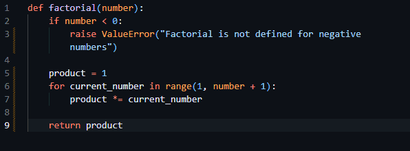

# 🧠 CodeCharm — AI-Powered Code Comment Generator for VS Code

CodeCharm is your intelligent VS Code extension that generates **inline code comments** using Google Gemini models. It uses your selected code and enhances it with **emoji-rich, concise comments** or **refactors it for readability**.

> 🚀 Now updated with **multi-model fallback support** and **secure API key input**!

<p align="center">
  
  
</p>
<p align="center">
  🌐 <a href="https://codecharm.netlify.app/" target="_blank"><b>🔗 Visit CodeCharm Web</b></a>  
</p>

---

## 🌟 Features

- ✍️ Generate **inline code comments** with emojis — clean and fun.
- ♻️ Refactor messy code to improve readability.
- ⌨️ **Shortcut support**:
  - `Ctrl + Win + J` → Add Inline Comments
  - `Ctrl + Win + G` → Refactor Code
  - `Ctrl + Win + H` → Comment + Refactor (adds inline emoji comments AND refactors the code)
  - `Ctrl + Win + K` → Run only the instruction inside `cmd()` (no other changes)
- 🔁 **Model Fallback Support**: Uses the following Gemini models in this order:
  1. `gemini-2.0-flash-lite`
  2. `gemini-2.0-flash`
  3. `gemini-2.5-flash-lite`
  4. `gemini-2.5-pro`
  5. `gemini-2.0-flash-exp`
  6. `learnlm-2.0-flash-experimental`
  7. `gemini-2.0-flash-live`
  8. `gemini-2.5-flash-live`
  9. `gemini-2.5-flash-native-audio-dialog`
- 🔐 **Secure API Key Storage** in VS Code settings.
- 🧠 Uses your **API key**, no sharing required.
- 🆕 **Execute `cmd()` instructions inside your code**  
  - Add a line like: `cmd(import pandas)` at the top of your code block.  
  - CodeCharm will first apply your instruction (e.g., add imports, modify setup)  
    and then generate inline comments or refactor the code. You can also run the combined action with `Ctrl + Win + H` to perform both at once.
    - Press `Ctrl + Win + K` to run only the `cmd()` instruction found in the selection (the extension sends only the `cmd()` instruction to the assistant and returns the modified code).
    > **Tip:** You can add a `cmd()` instruction before running CodeCharm  
> Example:
> ```js
> cmd(import pandas)
> df = pd.DataFrame({...})
> ```
> This will automatically insert the required import before processing.


---

## 🔑 Setup — Add Your API Key

To use CodeCharm, you'll need your **own Google Gemini API key**:

1. Go to [Google AI Studio](https://aistudio.google.com/app/apikey).
2. Copy your API key.
3. Open VS Code.
4. Press `Ctrl + Win + J` or `Ctrl + Win + G` for the first time.
  - Or press `Ctrl + Win + H` to run both commenting and refactoring in one step.
  - Press `Ctrl + Win + K` to run only the instruction inside `cmd()` in your selection.
5. A secure input box will appear → paste your key there.
6. It will be saved automatically in:  
> **Tip:** You can add a `cmd()` instruction before running CodeCharm  
> Example:
> ```js
> cmd(import pandas)
> df = pd.DataFrame({...})
> ```
> This will automatically insert the required import before processing.

   **`CodeCharm.zetaFlux`** in your VS Code settings.

> 🔐 Your key stays local & secure — not shared or stored remotely.

---

## 🚀 How to Use

1. Select a block of code.
2. Press:
   - `Ctrl + Win + J` → for inline comments
   - `Ctrl + Win + G` → to refactor code
  - `Ctrl + Win + H` → to both refactor and add inline emoji comments (follows any `cmd()` instructions)
  - `Ctrl + Win + K` → to only execute the `cmd()` instruction and return the modified code (no other changes)
3. CodeCharm will generate and replace your selection with an improved version.
> **Tip:** You can add a `cmd()` instruction before running CodeCharm  
> Example:
> ```js
> cmd(import pandas)
> df = pd.DataFrame({...})
> ```
> This will automatically insert the required import before processing.


---

## 🧪 Example Output

### Before:
```js
function getUser(id) {
  return db.query("SELECT * FROM users WHERE id = " + id);
}
```

## After (Ctrl + Win + J):
```js
function getUser(id) {
  return db.query("SELECT * FROM users WHERE id = " + id); // 🧑‍💻 Query user by ID
}
```

<p align="center">
  
</p>

## 📦 Extension Info

- 📁 **Extension ID**: `CodeCharm`
- 👨‍💻 **Publisher**: [`DeveloperPuneet`](https://github.com/DeveloperPuneet)
- 🔗 **GitHub Repo**: [CodeCharm](https://github.com/DeveloperPuneet/CodeCharm)
- 🧩 **VS Code Version**: `^1.50.0` and above
- 🧠 **AI Models Used**:
  - `gemini-2.0-flash-lite` (primary)
  - `gemini-2.0-flash`
  - `gemini-2.5-flash-lite`
  - `gemini-2.5-pro`
  - + other fallback models

## 🛟 Troubleshooting

- ❌ **Getting No Output or Errors?**
  - Make sure your Gemini API key is valid.
  - If it's missing or expired, you'll be prompted to input it when you try using the extension.
  - To manually update or check your key:  
    `Settings → Extensions → CodeCharm → zetaFlux`

- ⚠️ **Network Errors?**
  - Check your internet connection or if Google's Gemini API is reachable.
  - Avoid hammering it with hundreds of requests/minute — Google don’t play 😬

## 🧤 Contributions

- 💬 Ideas, feature requests, and PRs are all welcome!
- Fork it, star it ⭐, break it, rebuild it — just don’t write spaghetti 🍝
- All feedback = good feedback, especially with emojis.

<p align="center">
  <a href="https://buymeacoffee.com/developerpuneet" target="_blank">
    
  </a>
</p>

## 📜 License

**MIT** — Use it, hack it, improve it.  
You break it, you own it. 💥

> 💬 Built with brain, bugs & caffeine by [@DeveloperPuneet](https://github.com/DeveloperPuneet)  
> *“If your code can’t explain itself, at least let it drop some emoji bars 🎯.”*
